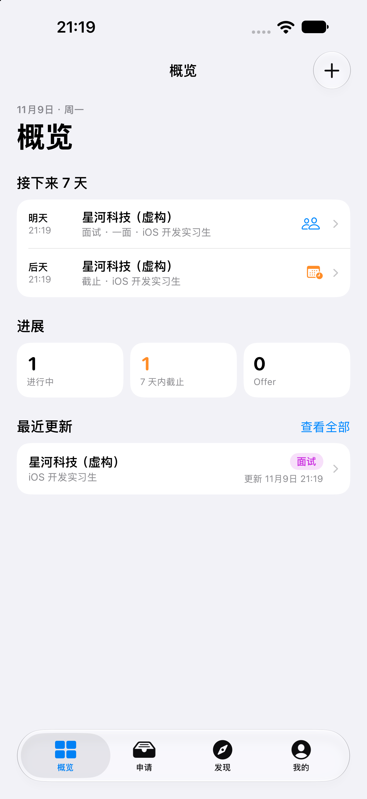
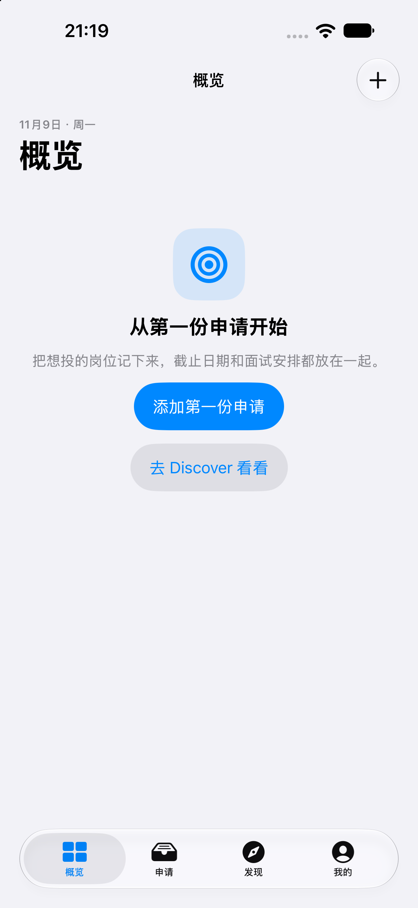
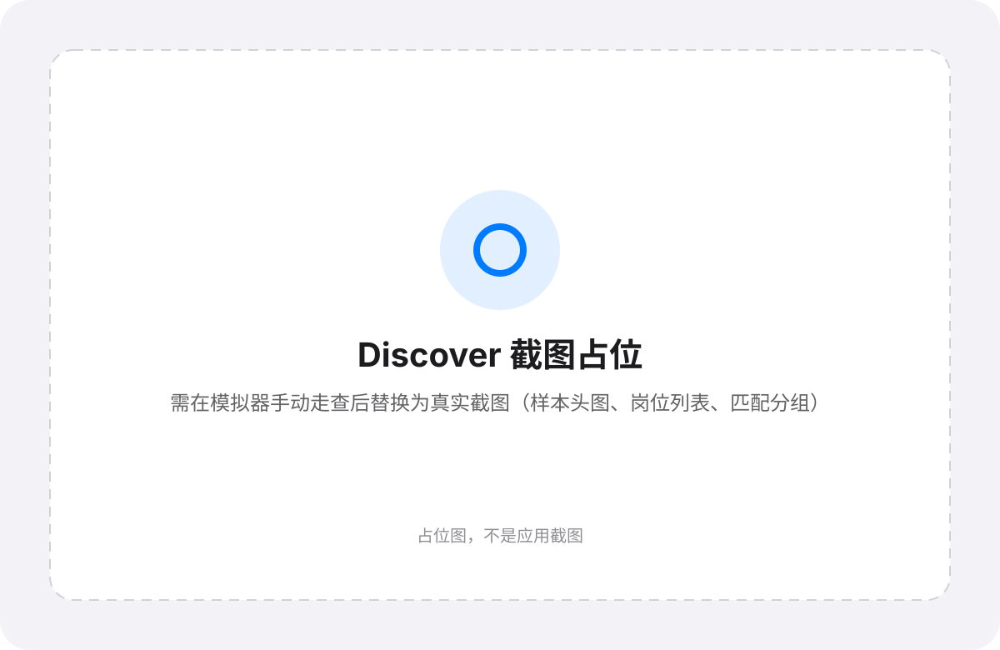
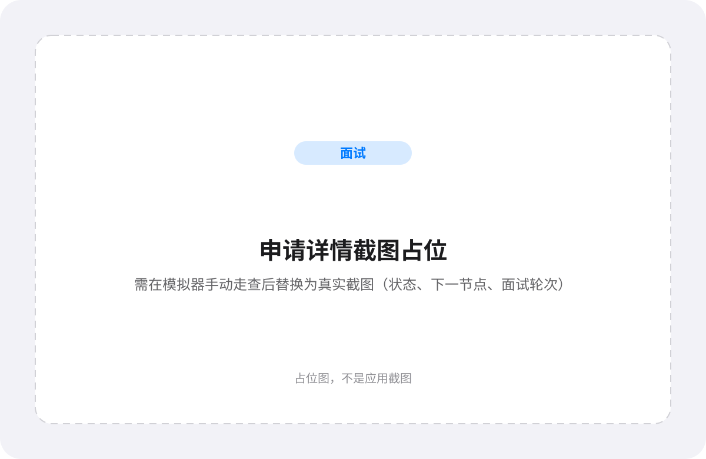

# NextStep

NextStep 是一个 iOS 实习申请追踪与岗位发现应用：把投递进度、状态历史、截止日期和面试轮次放在一个本机 App 里，并用**本地、可解释的规则匹配**回答「这份岗位匹配了什么、还缺什么、为什么是这个分数」。

所有数据只保存在本机；不登录、不云同步、不依赖任何第三方库。

> **仓库地址**：<https://github.com/wyf200562/NextStep>

## 项目简介与截图

NextStep 面向同时处理多份实习投递的求职者：一边记录申请，一边从每日岗位样本里筛选值得投的岗位。底部四个 tab：**概览**、**申请**、**发现**（页面标题为 Discover）、**我的**。

| 概览（含虚构演示数据，真实截图） | 概览（首次启动空状态，真实截图） |
|---|---|
|  |  |

| Discover（截图占位） | 岗位详情匹配（截图占位） |
|---|---|
|  |  |

| 申请详情（截图占位） |
|---|
|  |

> 截图说明：两张概览图是在 iPhone 模拟器上安装、启动后截取的真实画面；演示申请为虚构公司（星河科技）与虚构岗位。其余三张是**明确标注的占位图**，不是伪造的应用截图。当前自动化环境没有 UI 交互能力，Discover、岗位详情匹配、申请详情需在模拟器手动走查黄金路径后，用真实截图替换 `docs/images/discover-placeholder.svg`、`job-detail-match-placeholder.svg`、`application-detail-placeholder.svg`。

## 功能

### 申请追踪

- 新建、编辑、删除申请；公司、职位、链接、地点保存为快照，即使关联岗位被删除也能完整显示。
- 七态状态机：想投 → 已投 → OA/笔试 → 面试 → Offer；已拒 / 已撤可显式「重新打开」。允许跳级，回退和重开需要二次确认。
- 每次状态变化自动写入 append-only 的 `StatusChange`，可在 UIKit 状态历史页查看 from → to、时间与备注。
- Deadline（日期 + 可选时刻）与面试轮次（时间、形式、联系人、备注、结果）；添加未来轮次时可选择标记为「面试中」。
- 列表按全部 / 进行中 / 临近截止 / Offer / 已结束筛选，按最近节点或最近更新排序。

### 行动优先的概览

- 首屏先显示「今天」和「接下来 7 天」的截止与面试事件，点击直达申请详情。
- 一行三个计数：进行中 / 7 天内截止 / Offer，可点进对应筛选列表。
- 最近更新前 5 条；无数据时显示「添加第一份申请」「去 Discover 看看」两个入口。

### 岗位发现

- Discover 先读本地缓存，再按 6 小时 TTL 和滚动 24 小时 ≤4 次的配额刷新 Remotive 公共 API。
- 常驻「样本模式」头图：本机 Remotive 样本数、其中实习数、手动导入数、上次成功刷新时间与来源署名。
- 支持手动粘贴 JD（标题、公司、正文、地点、链接、类型、标签），不消耗 Remotive 配额；标题含 intern/实习时自动识别为实习。
- 断网、超时、限流、服务端错误或解码失败都有中文提示；有缓存时继续浏览，无缓存时提供重试与粘贴 JD 兜底。

### 本地可解释匹配

- 中英技能词典 + 方向/地点辅助词典 + 规则加权：技能 60 / 方向 20 / 地点 10 / 岗位类型 10。
- 输出分数、分档、匹配/缺失技能、四项分项、模板化一句话原因、evidence 和 eligibility。
- 描述为空或未识别到技能时标记低置信度；明确非实习或地点不可行时标为「不符合」，不给假 0 分。
- 匹配完全在本地、确定性地计算，不依赖 LLM、embedding 或网络。

### 数据与演示

- 5 个 SwiftData 模型与 `SchemaV1`；杀进程重启后申请、状态历史、轮次、画像和岗位缓存仍在。
- Debug 构建在「我的 → 关于」提供「清空演示数据」：删除全部本地记录并重置 Remotive 刷新配额；Release 构建不包含该入口。
- 演示申请和手动 JD 均为虚构内容；Discover 使用真实 Remotive 样本并保留署名与原岗位回链。

## 技术栈

- **Xcode 27 / iOS 27.0**，Swift 6 语言模式，默认 MainActor 隔离。
- **SwiftUI** 为主；唯一 UIKit 页面是申请详情里的状态历史（`UIViewController` + `UITableViewDiffableDataSource`）。
- **SwiftData**：单 `ModelContainer`、主线程 `ModelContext`、`VersionedSchema` V1。
- **Swift Testing**：`@Suite` / `@Test` / `#expect` / `#require`，表驱动、确定性、不联网。
- **os.Logger** 按层分 category；无 `print`。
- **零第三方依赖**，无 SPM 包。

## 架构图与分层

```mermaid
flowchart LR
    App[App<br/>NextStepApp · AppContainer · Router] --> Features[Features<br/>SwiftUI 页面 + ViewModel]
    Features --> Domain[Domain<br/>@Model · 状态机 · 匹配 · 仓库协议]
    Data[Data<br/>SwiftData 仓库 · JobSource · 词典加载 · RefreshLedger] --> Domain
    App --> Data
    Features --> Core[Core<br/>LoadState · DateProvider · HTML 归一化 · Logger]
    Data --> Core
```

| 层 | 职责 | 代表文件 |
|---|---|---|
| App | 组合根、路由、根 tab | `NextStep/App/AppContainer.swift` |
| Features | 页面、ViewModel、纯展示 helper | `NextStep/Features/Discover/DiscoverViewModel.swift` |
| Domain | 5 个 `@Model`、状态机、匹配引擎、仓库/来源协议 | `NextStep/Domain/Matching/MatchingEngine.swift` |
| Data | SwiftData 仓库、Remotive/手动来源、词典加载、刷新账本 | `NextStep/Data/Repositories/SwiftDataJobRepository.swift` |
| Core | 无业务依赖的基础设施 | `NextStep/Core/LoadState.swift` |

依赖方向为 **Features → Domain ← Data**，`App` 通过协议在组合根注入实现；`Domain` 不依赖 SwiftUI，也不依赖持久化容器。详细说明见 [架构与分层](docs/design/architecture.md)。

## 三个关键取舍

### 1. 匹配引擎：技能词典 + 规则加权，而不是 embedding / LLM

**为什么**：可解释、确定性、可单测、零 API 成本、无隐私外发。分数能直接对应到「哪项技能命中、哪项缺失、方向/地点/岗位类型各得几分」，面试时也可以现场解释。

**代价**：召回受词典覆盖限制，语义泛化弱，改写或未收录技能可能漏匹配。v1 接受这个限制；embedding 只作为未来 5–10 分的 tie-breaker 候选，不进入主分。

### 2. JobSource / JobPostingDraft / JobRepository 统一摄入缝

**为什么**：Remotive、手动粘贴和未来的 URL 导入都实现同一个 `JobSource`，只负责「取数 + 归一化」；`JobRepository` 是唯一持久化写入口，集中处理 `identityKey` upsert、刷新节流、缓存与错误映射。UI 和匹配不直接碰来源，测试用 fake source 即可。

**代价**：多一层协议和 draft 映射。但换来的是来源可替换、配额按来源独立、离线/失败行为集中可测。

### 3. SwiftData `@Model` 兼作领域模型 + 纯 `MatchingEngine`

**为什么**：不维护两套模型和双向映射，30 天预算里把复杂度留给业务规则；`MatchingEngine` 仍是纯结构，不持有 `ModelContext`、不做 I/O，可以直接用 `@Model` 实例作为输入并在单测中构造。

**代价**：Domain 层与 SwiftData 耦合，未来若要拆模块需要先引入值类型快照。ADR 记录了这条边界：[0002](docs/adr/0002-swiftdata-models-as-domain-model.md)。

## 运行方式

### 环境

- macOS + **Xcode 27**（含 iOS 27 模拟器运行时）。
- 无需安装任何依赖、CocoaPods 或 SPM 包。

### 在模拟器运行

1. 用 Xcode 打开 `NextStep.xcodeproj`。
2. Scheme 选择 `NextStep`，destination 选择任一 iPhone 模拟器（iOS 27.0）。
3. `Cmd + R` 运行。首次启动是空状态；从「发现」粘贴 JD 或等待 Remotive 刷新即可开始。

也可以在命令行构建：

```bash
xcodebuild -project NextStep.xcodeproj -scheme NextStep \
  -destination 'platform=iOS Simulator,name=iPhone 18 Pro' build
```

### 免费 Apple 账号说明

- 交付承诺只覆盖**模拟器演示**：模拟器运行不需要签名。
- 如果要用免费 Apple ID 在真机运行，个人团队签名 **7 天后过期**，需要重新签名；本项目不承诺真机安装包长期可用。
- 不包含 TestFlight / App Store 上架流程（免费账号不支持）。

### 演示数据与清空

- 申请和手动粘贴的 JD 全部使用虚构公司、虚构岗位与虚构正文，不复制任何真实 JD 全文，也不把虚构 JD 标成 Remotive 来源。
- Discover 的岗位来自真实 Remotive 公共 API，保留来源署名与原岗位回链。
- Debug 构建：**我的 → 关于 → 清空演示数据** 删除全部 SwiftData 记录（申请、岗位、面试轮次、状态历史、画像）并重置 Remotive 刷新配额；重新启动 App 后回到首次启动状态。Release 构建不编译该入口。
- 仓库不附带伪造的 Remotive 数据集，也不预置演示申请。

## 测试命令

```bash
xcodebuild -project NextStep.xcodeproj -scheme NextStep \
  -destination 'platform=iOS Simulator,name=iPhone 18 Pro' \
  test
```

- 使用 Swift Testing；全部测试离线运行，网络相关用例通过注入的 `URLSession` + `URLProtocol` stub 完成。
- 测试使用内存 SwiftData 容器、临时 `UserDefaults` suite 和可控时钟，不依赖真实网络、系统时钟或真实用户数据。
- 覆盖领域模型、状态机全转换、匹配规则边界、词典解析、Remotive DTO/HTTP 映射、仓库 upsert/节流/缓存、选定的 ViewModel 行为，以及 Debug 清空演示数据。

## Remotive 数据来源与合规声明

- Discover 的远程岗位来自 [Remotive](https://remotive.com/) 公共 API `https://remotive.com/api/remote-jobs`，无需鉴权。
- **署名与回链**：列表头图、岗位详情都注明「数据来源 Remotive」，并提供「打开原岗位」回链；岗位标题、公司与描述的版权归原发布方所有。
- **不转投第三方**：NextStep 不把 Remotive 数据转发到任何第三方招聘聚合站；用户始终回到 Remotive 或原始发布页面申请。
- **不收集注册/邮箱**：App 不收集岗位联系人邮箱、不要求注册，也不上传任何数据到服务器。
- **请求频率**：每一次刷新只发一个请求；滚动 24 小时最多 4 次网络尝试，两次至少间隔 60 秒。成功、失败、超时、离线、解码失败和被取消的请求都计入配额。
- **数据延迟**：Remotive 数据约有 24 小时延迟。
- **每日样本量**：公共 API 每天只提供约 10–12 条样本，**不是全量岗位**；条数少不是加载失败。
- **查询参数**：Remotive 的查询参数目前基本不生效，NextStep 默认无关键字、`category=software-dev`、上限 50，但返回结果仍以服务端为准。
- **实习可能为 0**：每日样本里实习岗位可能为 0；「只看实习」为空时会明确解释，并提供手动粘贴 JD 的兜底。
- **手动兜底**：手动粘贴 JD 完全本地、不消耗 Remotive 配额，是覆盖 Remotive 没有的实习岗位的主要方式。
- 仓库和演示数据集不复制真实 JD 全文。

## 已知限制与 P1 Roadmap

### v1 已知限制

- 岗位池受 Remotive 每日样本限制，不做全量聚合；查询参数过滤不可依赖。
- 匹配依赖词典覆盖，语义泛化和未收录技能召回有限；v1 不做 embedding / LLM。
- 可实习时间、毕业年份、时区在 v1 只展示，不参与计分。
- 不做本地通知或推送提醒；概览和列表是唯一的时间节点提示。
- 不做后台刷新；仅在应用内自动/下拉刷新。
- 不做 URL 导入、漏斗/状态分布图、全文搜索、自定义排序、CSV 导入导出。
- 不做账号、iCloud/CloudKit、多设备同步、Share Extension、Widget、App Group。
- 只承诺模拟器演示；免费账号真机签名 7 天过期。

### P1 Roadmap

- URL 导入公开岗位页面（独立配额，复用 `JobSource` 摄入缝）。
- 漏斗转化率与状态分布图（数据来自现有 `Application` / `StatusChange`）。
- 本地通知：截止日期与面试提醒（新增 `NotificationScheduling` 缝）。
- 匹配增强：embedding 作为 5–10 分 tie-breaker，仍保留规则主分与可解释性。
- 后台刷新与刷新状态可视化。
- 申请列表全文搜索、CSV 导出（独立评估）。

## 设计文档

- [架构与分层](docs/design/architecture.md)
- [匹配引擎设计](docs/design/matching-engine.md)
- [岗位摄入与数据流](docs/design/ingestion.md)
- [申请生命周期与概览派生](docs/design/application-lifecycle.md)
- [表现层与界面决策](docs/design/presentation.md)
- 架构决策记录：[ADR 0001](docs/adr/0001-single-target-layered-folders.md)、[ADR 0002](docs/adr/0002-swiftdata-models-as-domain-model.md)、[ADR 0003](docs/adr/0003-job-ingestion-seam.md)、[ADR 0004](docs/adr/0004-presentation-boundaries.md)
- 领域术语表：[GLOSSARY.md](GLOSSARY.md)

## License

[MIT](LICENSE) © 2026 wyf
