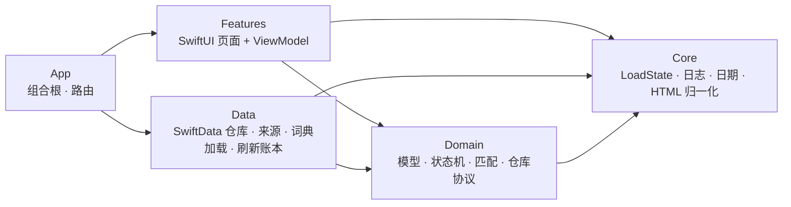

# 架构与分层

NextStep 是单 app target 的 SwiftUI 应用：一个 `ModelContainer`、一条主线程 `ModelContext`、一组仓库协议，以及按 `App / Features / Domain / Data / Core` 分层的目录。没有 SPM 模块，也没有第三方依赖。

## 依赖方向



- `Domain` 不依赖 Features / Data / App；允许 `import SwiftData`（仅 `@Model` 声明），不 `import SwiftUI`。
- `Features` 只依赖 `Domain` 的协议和值类型，不直接创建 Data 层实现。
- `Data` 实现 `Domain` 的仓库与来源协议；SwiftData 只出现在这一层和 `@Model`。
- `App` 是唯一的组合根：`NextStepApp` 创建 `AppContainer`，通过 SwiftUI environment 注入。

相关 ADR：[0001 单 target + 分层目录](../adr/0001-single-target-layered-folders.md)。

## 组合根

`AppContainer`（`@Observable @MainActor`）持有并装配：

- `ModelContainer` / `mainContext`；
- `SwiftDataApplicationRepository`、`SwiftDataUserProfileRepository`、`SwiftDataJobRepository`；
- `JobSourceFactory`（Remotive + 手动粘贴）、`RefreshLedger`；
- `MatchingLexicon` / `MatchService`（词典加载失败时为 nil，匹配与技能选择降级）；
- `AppRouter`（跨 tab 导航，不是 ViewModel）。

容器创建只发生一次；若本地 store 打不开，`AppRootView` 显示阻塞式中文错误页 + 重试，Debug 构建还可从「关于」清空数据后重启。

## 状态与数据流

- 所有写操作走仓库：Application、JobPosting、UserProfile 各有一个 `@MainActor` 协议 + SwiftData 实现。
- 页面按 spec 选择形态：
  - 只读页面（概览、申请列表、岗位列表）用 `@Query` + 纯函数派生，不配 ViewModel；
  - 有异步、表单或多步操作的页面用 `@Observable @MainActor` ViewModel；
  - 状态历史是唯一的 UIKit/MVC 页面，直接注入 `ApplicationRepository`。
- ViewModel 不持有 `ModelContext`，也不使用 `@Query`；它只调用仓库/匹配服务并映射中文文案。
- 匹配结果是派生数据：不写入任何表，每次读取重新计算。

相关 ADR：[0004 表现层边界](../adr/0004-presentation-boundaries.md)、[0002 @Model 兼作领域模型](../adr/0002-swiftdata-models-as-domain-model.md)。

## 领域模型与删除规则

5 个 `@Model`：`Application`、`JobPosting`、`InterviewRound`、`StatusChange`、`UserProfile`，全部属于 `SchemaV1` 并预留 `SchemaMigrationPlan`。

| 关系 | 删除规则 |
|---|---|
| `Application.interviewRounds` → `InterviewRound` | cascade |
| `Application.statusChanges` → `StatusChange` | cascade |
| `JobPosting.applications` → `Application` | nullify（Application 快照字段保留） |

`Application` 的公司、职位、链接、地点是快照，即使关联的 `JobPosting` 被删除仍可完整显示。`UserProfile` 由仓库 fetch-or-create 保证单例。

## 目录速查

```text
NextStep/
  App/          NextStepApp、AppContainer、RootTabView、AppRouter
  Features/     Overview、Applications、ApplicationDetail、StatusHistory、
                Discover、JobDetail、ManualImport、Profile
  Domain/       5 个 @Model、ApplicationStateMachine、Matching、JobSource 协议、仓库协议
  Data/         SchemaV1、SwiftData 仓库、Remotive/Manual 来源、词典加载、RefreshLedger
  Core/         LoadState、DateProvider、HTMLTextNormalizer、AppLogger
  Resources/    技能词典、方向词典、地点词典 JSON
```

## 并发与错误

- Swift 6 语言模式，默认 MainActor 隔离；网络与解码在后台，落库回主线程。
- Data 层抛 typed error（`JobSourceError`、`RepositoryError`、`ApplicationTransitionError`），ViewModel 映射中文文案；原始 error 只进 `os.Logger`，不展示给用户。
- 日志按 `app / data / matching / ui` 分 category，全仓库无 `print`。
