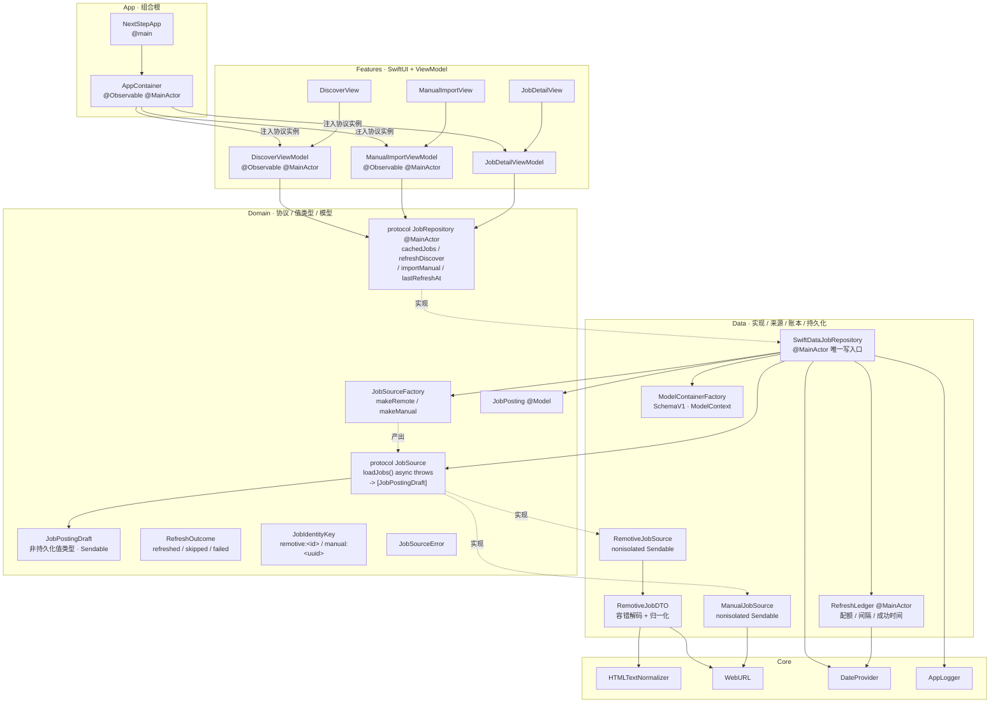
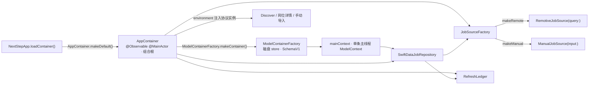
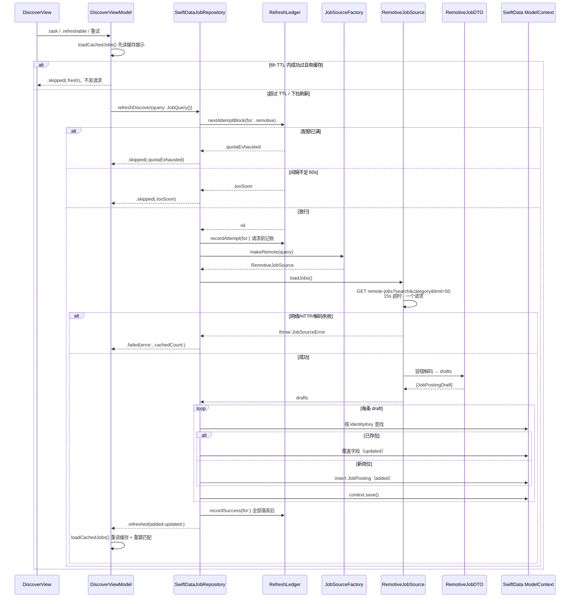
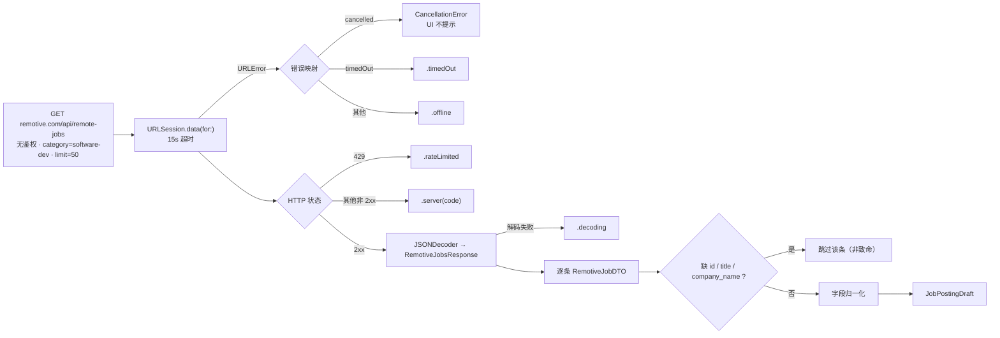
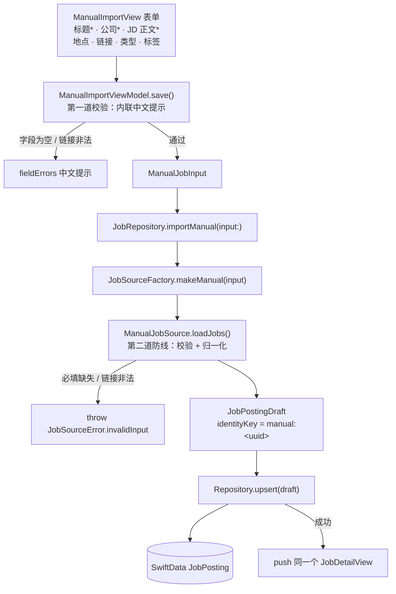
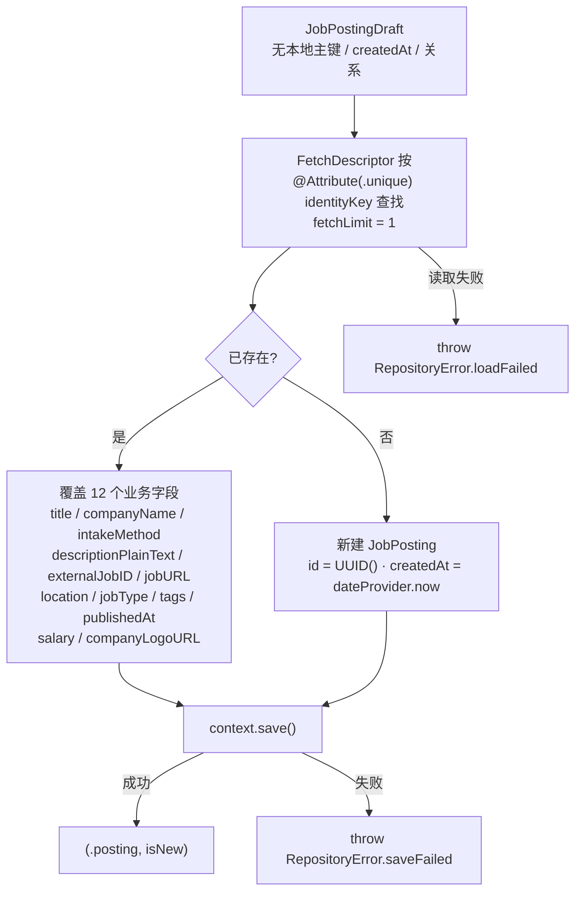
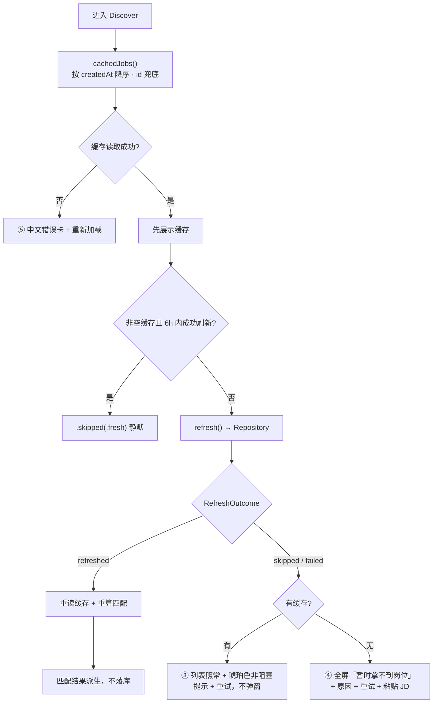

# 岗位摄入架构详图

本文是 [ingestion.md](ingestion.md) 的展开版：把「来源 → `JobPostingDraft` → `JobRepository` → `JobPosting`」这条缝落到具体类型、方法、并发隔离和分支结果上。所有类型名、方法名与源码一致；配套分层背景见 [architecture.md](architecture.md)，决策依据见 [ADR 0003 统一摄入缝](../adr/0003-job-ingestion-seam.md)。

## 1. 总览：分层与依赖

**边界约束**（源码与 ADR 0003 / 0004 一致）：

- `JobSource` 只负责「取数 + 归一化」，不持久化、不节流；`JobRepository` 只负责「存 + 节流 + 错误」。
- Features 只依赖 Domain 的协议和值类型，不直接构造 Data 层实现；ViewModel 不持有 `ModelContext`，也不使用 `@Query`。
- SwiftData 只出现在 Data 层与 `@Model` 声明；UI 和匹配永远不直接接触来源，来源也不接触 SwiftData。
- 网络与解码在后台（`nonisolated` 来源），落库回主线程（`@MainActor` 仓库）；原始 error 只进 `os.Logger`，ViewModel 映射中文文案。

## 2. 组合根装配

`NextStepApp` 启动时创建一次 `AppContainer`，经 SwiftUI environment 注入；容器内把协议绑到 SwiftData 实现。

- 测试与 Preview 走 `makeInMemory`：内存 store + 一次性 `UserDefaults` suite，不会污染本机配额账本。
- 本地 store 打不开时，`AppRootView` 显示阻塞式中文错误页 + 重试；Debug 可从「关于」清空数据后重启。

## 3. 远程刷新路径（Remotive）

### 3.1 时序

### 3.2 节流决策（`RefreshLedger`）

账本按 `JobIntakeMethod` 分源维护，持久化在 `UserDefaults`，测试注入临时 suite。

| 规则 | 值 | 实现位置 |
|---|---|---|
| 滚动窗口配额 | 24h 内最多 **4** 次网络尝试 | `maxAttemptsPerRollingWindow` / `rollingWindow` |
| 最小间隔 | 两次尝试至少 **60 秒** | `minimumAttemptInterval` |
| 自动刷新 TTL | 以最近一次成功为准 **6 小时** | `DiscoverViewModel.automaticRefreshInterval` |
| 判定顺序 | 先判配额，再判间隔；同时命中 → `.quotaExhausted` | `nextAttemptBlock(for:)` |
| 记账时机 | 请求**发起前** `recordAttempt`：成功/失败/超时/离线/解码失败/取消都计数 | `refreshDiscover(query:)` |
| 成功时间 | 整批草稿全部落库后才 `recordSuccess`；保存失败不更新「更新于」 | `recordSuccess(for:)` |

- 下拉刷新、重试忽略 6h TTL，但仍受配额与 60s 间隔约束。
- 未来 URL 源有独立配额，不和 Remotive 共用。

### 3.3 来源内归一化与容错（`RemotiveJobSource` + DTO）

- `identityKey = remotive:<id>`；`externalJobID = String(id)`；描述经 `HTMLTextNormalizer`；`jobType` 原样小写。
- 缺 `description` 按空串；坏日期置 nil；`url` / `company_logo_url` 非 http(s) 绝对地址置 nil；未知字段、`total-job-count`、`00-warning` 忽略或仅日志。
- 200 + 0 条与 200 + 12 条都算成功，不当作错误。

## 4. 手动粘贴路径

- 手动导入**不写 `RefreshLedger`**，不消耗 Remotive 配额。
- 未选岗位类型且标题含 `intern` / `实习` → 保存为 `internship`；标签 trim、去空、按首次出现去重。
- 校验分两层：ViewModel 做内联提示，`ManualJobSource` 是最终防线；链接必须是带 host 的 http(s) 地址（`WebURL.isValid`）。
- 保存成功后直接进入岗位详情，从那里匹配并导入申请；返回 Discover 时 `onAppear` 重读缓存。

## 5. 草稿到持久化：upsert 内部

- `identityKey` 是跨刷新稳定身份：同一岗位更新而不是重复插入；本地 `id` 与 `createdAt` 只在新建时由仓库分配。
- `updated` 的语义是本次刷新 **touch 到的已有 identityKey 数量**，因此 `added + updated` 恒等于本次草稿数。
- 刷新从不删除旧岗位：它们可能已被 `Application` 关联；`JobPosting.applications` 删除规则为 nullify，申请快照字段保留。

### 5.1 落库模型（SchemaV1）

| 模型 | 与岗位摄入的关系 |
|---|---|
| `JobPosting` | 岗位主记录；`identityKey` 唯一；`intakeMethod` 区分 remotive / manual / url |
| `Application` | 引用 `JobPosting`（nullify），公司/职位/链接/地点为快照 |
| `InterviewRound` | 归属 `Application`，cascade |
| `StatusChange` | 归属 `Application`，append-only，cascade |
| `UserProfile` | 匹配输入，仓库 fetch-or-create 单例 |

## 6. 读取、缓存与离线降级

- `JobPosting` 不存 `fetchedAt`；「更新于」由 ledger 的 `lastSuccess` 提供；样本计数 N/M/K 每次从缓存重算，不写死。
- 匹配结果是派生数据：每次读取重新计算，不写入任何表。
- 取消（`CancellationError`）不显示错误；`.skipped(.fresh)` 与取消均为静默。

## 7. 错误分类与中文文案映射

Data 层抛 typed error，ViewModel 经 `JobSourceError.message(for:fallback:)` 取同一份中文文案；原始 error 只进 `os.Logger`（`data / matching / ui` 分 category），不展示给用户。

| `JobSourceError` | 触发场景 | 用户文案 |
|---|---|---|
| `.invalidInput` | 手动必填缺失 / 链接非法；来源返回空草稿 | 请检查必填项 |
| `.offline` | 网络不可用 | 网络不可用，请检查连接 |
| `.timedOut` | 请求超时 | 请求超时，请稍后重试 |
| `.rateLimited` | HTTP 429 | 请求过于频繁，请稍后再试 |
| `.server(code)` | 其他非 2xx | 服务器暂时不可用（HTTP code） |
| `.decoding` | 响应解码失败 / 非 HTTP 响应 | 数据格式暂时无法识别 |
| `CancellationError` | 请求被取消 | 不提示 |
| `RepositoryError.loadFailed / saveFailed` | 本地读取 / 保存失败 | 加载失败，请稍后重试（兜底） |

## 8. 类型索引

| 层 | 类型 | 职责 |
|---|---|---|
| Domain | `JobSource` | 摄入缝协议：`intakeMethod` + `loadJobs() async throws -> [JobPostingDraft]` |
| Domain | `JobPostingDraft` | 非持久化草稿；字段对齐 `JobPosting`，去掉本地主键、`createdAt`、关系 |
| Domain | `JobSourceFactory` | 按输入构造来源；让测试注入 fake，ViewModel 不碰来源类型 |
| Domain | `JobRepository` | `@MainActor` 协议：缓存读取、刷新 upsert、手动导入、最近成功时间 |
| Domain | `RefreshOutcome` | `.refreshed(added:updated:)` / `.skipped(fresh/quotaExhausted/tooSoon)` / `.failed(error:cachedCount:)` |
| Domain | `JobIdentityKey` | 来源限定的稳定身份：`remotive:<id>`、`manual:<uuid>` |
| Domain | `JobSourceError` / `RepositoryError` | typed 错误 + 单一中文文案入口 |
| Data | `SwiftDataJobRepository` | 协议实现；唯一持久化写入口；节流编排与 upsert |
| Data | `RemotiveJobSource` | 网络请求、HTTP/错误映射；不解耦持久化 |
| Data | `RemotiveJobDTO` | 容错解码、字段归一化、日期解析、草稿组装 |
| Data | `ManualJobSource` | 表单输入校验、归一化、实习推断、标签去重 |
| Data | `RefreshLedger` | 分源配额 / 间隔 / 成功时间，UserDefaults 持久化 |
| Data | `ModelContainerFactory` / `SchemaV1` | 单容器、版本化 schema、迁移计划 |
| Features | `DiscoverViewModel` | 缓存状态、刷新循环、派生分组、离线提示决策 |
| Features | `ManualImportViewModel` | 表单状态、第一道校验、保存生命周期 |
| Features | `JobDetailViewModel` | 缓存岗位查找、导入 CTA 去重状态 |
