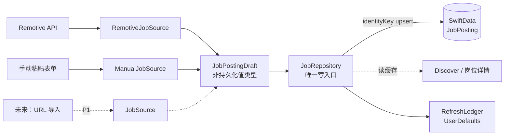

# 岗位摄入与数据流

所有岗位都走同一条缝：**来源 → `JobPostingDraft` → `JobRepository` → `JobPosting`**。UI 和匹配永远不直接接触来源，来源也不接触 SwiftData。



相关 ADR：[0003 统一摄入缝](../adr/0003-job-ingestion-seam.md)。

## 协议

```swift
protocol JobSource {
    var intakeMethod: JobIntakeMethod { get }
    func loadJobs() async throws -> [JobPostingDraft]
}
```

- `JobSourceFactory.makeRemote(JobQuery)` / `makeManual(ManualJobInput)` 按输入创建来源。
- `JobPostingDraft` 与 `JobPosting` 的必填/可选字段对齐，去掉本机主键 `id`、`createdAt` 和关系；`identityKey` 由来源生成。
- 归一化（trim、HTML → 纯文本、日期解析）在来源侧完成；Repository 只信任 draft。
- 手动实现虽然是同步的，协议仍统一为 `async throws`。

## JobRepository

`@MainActor` 协议 + SwiftData 实现，是唯一的持久化写入口：

- `cachedJobs()`：按 `createdAt` 降序、同时间 `id` 兜底。
- `refreshDiscover(query:) -> RefreshOutcome`：节流检查 → 记账 → 拉取 → 按 `identityKey` upsert。
- `importManual(_:) -> JobPosting`：手动导入单条，**不写 RefreshLedger**。
- `lastRefreshAt(for:)`：只反映最近一次成功刷新。
- `RefreshOutcome`：`.refreshed(added:updated:)` / `.skipped(.fresh/.quotaExhausted/.tooSoon)` / `.failed(error:cachedCount:)`。

`updated` 的语义是本次刷新 **touch 到的已有 identityKey 数量**，因此 `added + updated` 恒等于本次草稿数。刷新从不删除旧岗位：它们可能已被 Application 关联，且每日样本量很小。

## 刷新节流

`RefreshLedger` 按 `JobIntakeMethod` 分源维护，持久化在 `UserDefaults`（测试注入临时 suite）：

- 滚动 24 小时最多 **4 次网络尝试**；成功、失败、超时、离线、解码失败、被取消的请求都计数，因为在请求发起前就记账。
- 两次尝试至少间隔 **60 秒**。
- 自动刷新 TTL **6 小时**，以最近一次成功刷新为准；下拉刷新忽略 TTL，但仍受配额与间隔限制。
- 先判配额再判间隔；两者同时命中时返回 `.quotaExhausted`。
- `lastSuccess` 只在整批草稿全部落库后更新；保存失败不更新「更新于」。
- 未来 URL 源有独立配额，不和 Remotive 共用。

## Remotive 来源

- 端点：`GET https://remotive.com/api/remote-jobs`，无鉴权；默认无关键字、`category=software-dev`、`limit=50`，每次刷新只发一个请求，15 秒超时。
- DTO 容错：缺 `id` / `title` / `company_name` 的条目跳过；缺 `description` 按空串；坏日期置 nil；`url` / `company_logo_url` 非 http(s) 绝对地址置 nil；未知字段、`total-job-count`、`00-warning` 忽略或仅日志。
- 200 + 0 条与 200 + 12 条都算成功，不当作错误。
- HTTP 映射：429 → `.rateLimited`；其他非 2xx → `.server(code)`；超时 → `.timedOut`；网络不可用 → `.offline`；解码失败 → `.decoding`；取消 → `CancellationError`（UI 不提示）。
- 映射：`identityKey = remotive:<id>`、`externalJobID = String(id)`、描述经 `HTMLTextNormalizer`、`jobType` 原样小写。

## 缓存与离线

1. 先读缓存并展示，再决定是否后台刷新。
2. 6 小时内成功刷新过且有缓存 → 不自动刷新。
3. 有缓存 + 刷新失败/配额用尽/太频繁 → 列表照常可用 + 琥珀色非阻塞提示 + 重试；不弹窗打断。
4. 无缓存 + 刷新失败/配额用尽/太频繁 → 全屏「暂时拿不到岗位」+ 原因说明 + 重试 + 粘贴 JD。
5. 缓存读取失败 → 中文错误卡 + 重新加载。
6. 取消不显示错误。

`JobPosting` 不存 `fetchedAt`；「更新于」由 ledger 提供，样本计数 N/M/K 每次从缓存重算，不写死。

## 手动粘贴 JD

- 字段：标题*、公司*、JD 正文*、地点、链接、岗位类型、标签。
- 校验在 ViewModel（内联中文提示）和 `ManualJobSource`（最终防线）各做一次；链接必须是带 host 的 http(s) 地址。
- 未选岗位类型且标题含 `intern` / `实习` → 保存为 `internship`。
- 标签 trim、去空、按首次出现去重。
- `identityKey = manual:<uuid>`，不消耗 Remotive 配额、不写 ledger。
- 保存成功后直接 push 同一个 `JobDetailView`，从那里匹配并导入申请；返回 Discover 时重读缓存。
